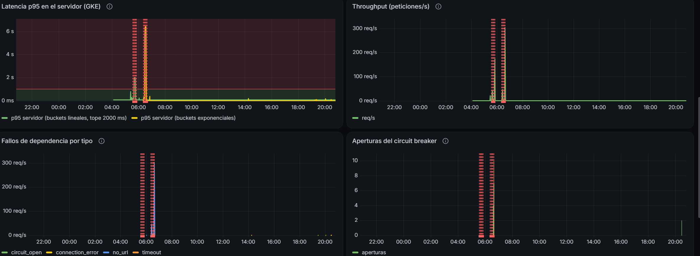
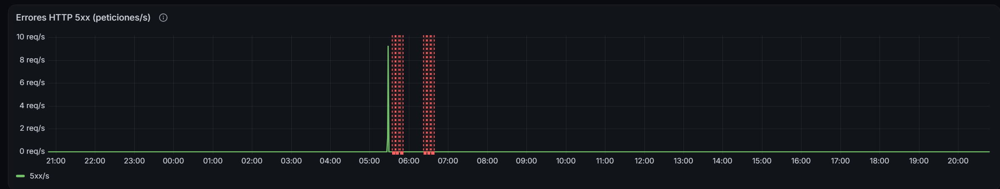

# Informe de experimento — Ingeniería del Caos (Seguimiento #4)

> Flujo multinube **api-fastify (Azure/AKS) → deport-back (GCP/GKE) → Inventario-U (OCI)**.
> Fecha de ejecución: 2026-11-17 (UTC). Versión: v4.0.0.
> Las secciones marcadas **[pendiente]** dependen de datos que aún no entrega el integrante; no se rellenan con supuestos.

## 1. Arquitectura y radio de impacto

- **Punto de entrada (coordinador):** api-fastify, `GET /api/v2/articulos/:id` (Azure). Invoca a deport-back y a Inventario-U propagando `X-Trace-Id` y autenticando con `X-Api-Key` (`TEAM_API_KEY`).
- **deport-back (GCP):** `GET /api/v2/deportistas/:id`, desplegado en Cloud Run y en GKE Autopilot (2–5 réplicas con HPA, probes de liveness/readiness, requests/limits, sidecar Cloud SQL Proxy). Llama a Inventario-U `GET /api/v2/skus` como dependencia.
- **Inventario-U (OCI):** expuesto por HTTPS (túnel Cloudflare).
- **Trazabilidad verificada:** con `X-Trace-Id: verif-cadena-002` (2026-11-17 05:22 UTC) el coordinador obtuvo 200 en 1,06 s y deport-back devolvió el mismo `trace_id` junto con los datos de Inventario-U.
- Diagrama con puntos de inyección y fronteras: ver `README.md` → *Ingeniería del Caos — Seguimiento #4*.

| Integrante / servicio | Fallo | Radio de impacto |
|---|---|---|
| deport-back (GCP) | **b** — indisponibilidad de la dependencia Inventario-U | Solo el deployment `deport-back` en GKE y su llamada saliente a `/api/v2/skus`. Cloud Run, Inventario-U y api-fastify no se tocan. Datos sintéticos. |
| api-fastify (Azure) | **a** — latencia de 3000 ms en la llamada saliente hacia deport-back durante 60 s | Llamada saliente de api-fastify en AKS. |
| Inventario-U (OCI) | **c** — agotamiento de recurso **[pendiente]** | **[pendiente]** |

## 2. Instrumentos y perfil de carga

- **Carga:** k6, perfil fijo `perfil-p1-v1` (`load/k6-flow.js`): 0→5 VUs en 30 s, 5 VUs 1 m 30 s, 5→10 en 30 s, 10 VUs 1 m 30 s, 10→0 en 30 s (**4 m 30 s**). No es sobreescribible por variables de entorno, así que es idéntico en todas las mediciones.
- **Métrica objetivo de deport-back:** p95 de latencia extremo a extremo de `GET /api/v2/deportistas/:id`, medido por k6 en el cliente. Umbral **< 1000 ms**; guardarraíl: tasa de error HTTP < 1 %.
- **Observación complementaria:** logs JSON de GKE en Cloud Logging y métricas basadas en logs en Cloud Monitoring (dashboards `chaos` y `canary`).
- **Inyección:** herramienta declarativa **Chaos Toolkit** (`chaos/experiments/dependency-unavailable.experiment.json`) e interruptor propio por variable de entorno (`CHAOS_DEPENDENCY_FAILURE`, `CHAOS_DEPENDENCY_TARGET`, `CHAOS_DEPENDENCY_MODE=hang`). En modo *hang* la dependencia no responde y la llamada espera hasta el timeout. Se descartó Chaos Mesh porque GKE Autopilot no admite sus componentes privilegiados; el manifiesto `NetworkChaos` se conserva y solo se aplica si el CRD existe.
- **Ejecución:** chaos gate en GitHub Actions ([run 44024828423](https://github.com/redundante3452/deportBack/actions/runs/44024828423)), `execution_id = exp-b-20261117`, trace ids `exp-b-20261117-<ronda>-<vu>-<iter>`. Evidencia: `docs/evidencia/exp-b-20261117/`.
- **Condiciones de aborto:** error > 50 % sostenido durante 60 s, pods no Ready, o parada manual. **Reversión automática:** `trap` en `scripts/run-chaos-experiment.sh` desactiva el interruptor, reactiva el breaker y espera el rollout.

## 3. Estado estable (medido)

| Métrica (k6, `perfil-p1-v1`) | Valor |
|---|---|
| p95 | **291 ms** |
| Mediana | 205 ms |
| Error HTTP | 0 % (8172 peticiones) |
| Throughput | 30,3 req/s |

Ventana: 2026-11-17 05:34:34–05:39:04 UTC, sin fallo, breaker activo.

## 4. Hipótesis

**deport-back:** *Dado el perfil de carga `perfil-p1-v1`, cuando Inventario-U deje de responder (interruptor en modo hang) durante 4 m 30 s, el flujo `GET /api/v2/deportistas/:id` mantendrá un p95 < 1000 ms.*

**api-fastify:** *Dado su perfil fijo, cuando se inyecten 3000 ms de latencia hacia deport-back durante 60 s, el flujo mantendrá un p95 < 2000 ms.*

**Inventario-U:** **[pendiente]**

## 5. Resultados de deport-back

Misma carga, mismo fallo, misma duración, mismo instrumento.

| Medición | Breaker | Ventana UTC | p95 | Mediana | Error HTTP | req/s |
|---|---|---|---|---|---|---|
| Estado estable | on | 05:34:34–05:39:04 | 291 ms | 205 ms | 0 % | 30,3 |
| **Ronda 0** | **off** | 05:40:12–05:44:45 | **5126 ms** | 5045 ms | 0 % | 1,3 |
| **Ronda 1** | **on** | 05:46:38–05:51:08 | **50 ms** | 48 ms | 0 % | 113,7 |

- Estado estable → Ronda 0: p95 **+1660 %** → **hipótesis refutada**.
- Ronda 0 → Ronda 1: p95 **−99,0 %** → **hipótesis cumplida**. El chaos gate **aprobó**.

| Fallos de dependencia (Cloud Logging) | Timeout 5 s | Circuito abierto |
|---|---|---|
| Ronda 0 | 361 | 0 |
| Ronda 1 | 60 | 30 640 |

### Diagnóstico de la Ronda 0 (mecanismo, no solo síntoma)

Modo de fallo: **saturación por un timeout demasiado largo**. Con el breaker desactivado, cada petición espera los 5 s del timeout por dependencia antes de degradar (las 361 peticiones registran *tiempo de espera agotado*). Como k6 es un modelo cerrado, cada VU queda bloqueado 5 s y el throughput cae de 30,3 a 1,3 req/s. No hay errores HTTP: la degradación devuelve 200 con `apis_externas.inventario_u` en error, pero tarde. Bajo una carga abierta (tráfico real), esa espera acumularía conexiones y workers ocupados hasta agotar la capacidad del pod: un fallo en cascada hacia el coordinador.

#### Evidencia correlacionada (ensayo, Ronda 0)

Cloud Logging, GKE, namespace `deport-back`, 2026-11-17 UTC (ensayo `ensayo-b-20261117`):

| Hora UTC | Evento | trace_id | Detalle |
|---|---|---|---|
| 06:29:28.862 | `dependency_failure` | `ensayo-b-20261117-r0-5-10` | dependency `inventario-u`, error_type `timeout`: "tiempo de espera agotado llamando a …/api/v2/skus (caos)" |
| 06:29:28.863 | `http_request` | (no lo incluye) | GET `/api/v2/deportistas/296f5b48-…`, status 200, duration_ms **5003** |
| 06:29:28.639 | `dependency_failure` | `ensayo-b-20261117-r0-3-13` | timeout; su `http_request` registra **5001** ms |

El `http_request` aparece 1 ms después del `dependency_failure`, en el mismo pod: es la misma petición. Hoy el evento `http_request` no lleva `trace_id`, así que la correlación se hace por marca de tiempo y pod (limitación registrada en el backlog). Mecanismo: con el breaker apagado, cada petición espera los 5 s completos del timeout, los VU de k6 quedan bloqueados y el throughput cae a ~1,3 req/s con p95 ≈ 5 s. Contraste en la Ronda 1 (ventana 06:34:19–06:38:51): el primer `circuit_breaker_opened` es a las 06:34:32.254, 13 s después de iniciar la inyección; desde entonces las respuestas degradadas (`circuit_open`) tardan milisegundos. Consulta usada en Cloud Logging: `jsonPayload.trace_id="ensayo-b-20261117-r0-5-10"`.

### Mejora aplicada y comportamiento en la Ronda 1

Patrones: **timeout por dependencia (5 s)**, **circuit breaker** (abre tras 3 fallos consecutivos, cooldown 30 s) y **degradación elegante** (respuesta parcial). En la Ronda 1 el circuito se abrió al tercer timeout y rechazó **30 640** llamadas al instante. Cada 30 s dejó pasar una sonda que volvió a fallar (los 60 timeouts restantes y el máximo de 5276 ms).

**Compromiso declarado:** el p95 de la Ronda 1 (50 ms) es menor que el del estado estable (291 ms) porque **se omite la llamada a Inventario-U**: el 100 % de las respuestas de la Ronda 1 fueron **degradadas**. El patrón cambia completitud por latencia y disponibilidad; no hace al sistema "más rápido" en condiciones normales.

## 6. Resultados de los compañeros

**api-fastify (fallo a, reportado por el integrante):** estado estable p95 441 ms · Ronda 0 p95 **3312 ms** (refuta; timeout de 5 s mayor que la latencia inyectada de 3 s → timeouts demasiado largos) · Ronda 1 p95 **496 ms** (−85 %) con timeout de 1 s + circuit breaker + degradación; 26 % de respuestas degradadas y 0 errores HTTP. Reversión verificada en 2 s.

**Inventario-U (fallo c):** **[pendiente]**

## 7. Hallazgos inesperados

1. **Cascada por el orden de apagado del sidecar.** En el primer intento, cada `kubectl set env` del experimento disparaba un rolling update. El sidecar `cloud-sql-proxy` moría al instante con SIGTERM mientras la app seguía recibiendo tráfico → `ECONNREFUSED 127.0.0.1:5432` → **137 de 161** respuestas 500 en un minuto, en pleno estado estable (05:26–05:28 UTC). Corrección: `preStop` de 10 s en la app, `preStop` de 15 s y `--max-sigterm-delay` en el proxy, y espera de estabilización de 40 s antes de medir. Tras la corrección: 2759/2759 respuestas 200.
2. **Telemetría ciega a los fallos de dependencia.** Los eventos `dependency_failure` salían del logger de Nest como texto con ANSI (no JSON), así que la métrica basada en logs `dependency_failures` no contaba nada. Los conteos de la sección 5 se obtuvieron sobre el texto del log. Se corrige emitiendo JSON estructurado y añadiendo la métrica `circuit_breaker_opened`.
3. **Gate mal planteado.** El primer diseño exigía que las dos rondas cumplieran el umbral, lo que es imposible si la Ronda 0 debe refutar. Además, k6 abortaba el pipeline en la Ronda 0. Ahora el gate decide por la Ronda 1 y la métrica objetivo, y publica la tabla. api-fastify encontró lo mismo al contar respuestas degradadas como fallo.
4. **El interruptor original no reproducía el fallo.** Fallaba de inmediato, sin latencia: la Ronda 0 no habría refutado nada. Se introdujo el modo *hang*.

## 8. Backlog de resiliencia

- Reducir el timeout por dependencia a un valor derivado del p99 del estado estable (≈1 s), como hizo api-fastify.
- Estado *half-open* real (una sola sonda) en lugar de reiniciar el contador tras el cooldown.
- Caché del último valor bueno de Inventario-U para degradar con datos y no con error.
- Bulkhead/límite de concurrencia por dependencia y prueba con carga abierta (arrival-rate) para observar la cascada.
- URL estable para Inventario-U (el túnel temporal cambia al reiniciarse) y HTTPS en api-fastify.
- Propagar `trace_id` al evento `http_request` para correlacionar por id y no por marca de tiempo y pod.
- Unificar los manifiestos de `k8s/` con `terraform/gke_workloads.tf` (hoy duplicados con valores distintos).

## 9. Tablero

Grafana Cloud, fuente **Google Cloud Monitoring** (service account de solo lectura `grafana-reader`, rol `monitoring.viewer`):

- deport-back: <https://niftyivy3144.grafana.net/d/caos-deport-back-b> (carpeta *Caos - Indisponibilidad de dependencia (GCP)*), versionado como código en `observability/grafana/caos-deport-back.json` (generado por `build_dashboard.py`).
- api-fastify: carpeta *Caos - Latencia saliente (Azure)* en la misma instancia.
- Muestra las ventanas de inyección del estado estable, la Ronda 0 y la Ronda 1 como anotaciones con `execution_id`, junto a la latencia p95 del servidor, el throughput, los 5xx, los fallos de dependencia por tipo, las aperturas del circuit breaker y la CPU por pod.
- Limitación detectada: la métrica de latencia original usa buckets lineales hasta 2000 ms y satura en la Ronda 0. Se añadió `http-latency-exp` con buckets exponenciales. El p95 oficial es el de k6.
- Capturas del tablero `caos-deport-back-b` (vista de 24 h del 17-nov; las franjas punteadas rojas son las anotaciones de inyección del experimento oficial ~05:30 y del ensayo ~06:28–06:38 UTC):

En la Ronda 0 el p95 en servidor sube a ~5–6 s (umbral 1 s en rojo) y el throughput cae; en la Ronda 1 aparecen los `circuit_open` (fallos rápidos) y las aperturas del breaker, y el throughput sube porque las respuestas degradadas son inmediatas.

El pico de 5xx de ~05:28 UTC es anterior a las ventanas medidas: corresponde al hallazgo del sidecar `cloud-sql-proxy` durante un rollout (corregido con `preStop`); dentro de las ventanas de inyección los 5xx son 0.

## 10. Uso de IA (declaración)

Herramienta: **Claude Code** (Anthropic), como asistente de análisis e implementación con revisión humana.

- **Propuso y se adoptó:** el modo *hang* del interruptor (el fallo inmediato no reproducía el modo de fallo); decidir el gate por la Ronda 1; el diagnóstico del sidecar a partir de los logs del proxy; la cadena api-fastify → deport-back → Inventario-U para que la dependencia de deport-back fuera la del experimento; la lectura del compromiso de la degradación en la Ronda 1.
- **Propuso y se descartó:** usar Chaos Mesh como inyección principal (GKE Autopilot no lo admite); llamar desde deport-back a api-fastify (es HTTP y provocaría un bucle con el coordinador).
- **Errores de la IA corregidos con evidencia:** guardó `TEAM_API_KEY` como `-` en GitHub (`gh secret set --body -`) y recortó un espacio en los filtros de métricas (`ANDjsonPayload`). Ambos se detectaron al contrastar con las respuestas reales (401 inesperado y error 400 de Cloud Logging).
