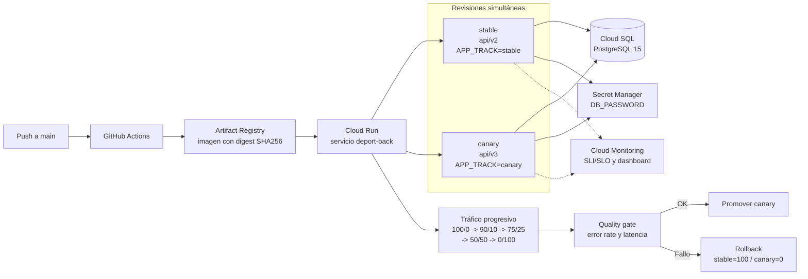

# Infraestructura y Canary Deployment de deport-back en Google Cloud

Esta carpeta despliega la API NestJS en Cloud Run y GKE Autopilot, además de
PostgreSQL 15 en Cloud SQL.
También contiene la infraestructura de observabilidad del despliegue Canary.
Los recursos están separados por servicio para facilitar su revisión y mantenimiento.
Cloud Run y Artifact Registry usan `region`; Cloud SQL usa `db_region`.

## Arquitectura Canary

Cloud Run usa un único servicio con dos revisiones inmutables:



Flujo operativo:

```text
Cliente
  |
  v
Cloud Run deport-back
  |-- tag stable  -> api/v2, APP_TRACK=stable
  `-- tag canary  -> api/v3, APP_TRACK=canary
                         |
                         `-- Cloud SQL PostgreSQL
```

Cada respuesta incluye `X-App-Version` y `X-App-Track`. La versión canary agrega
el campo opcional `nivel` a `deportistas`; la columna se crea nullable, por lo que
api/v2 sigue funcionando durante todo el despliegue. Este es el paso **Expand**.
El paso **Contract** (hacer obligatorio o eliminar el campo) queda fuera del
despliegue y solo se realizaría después de retirar api/v2.

El pipeline usa una imagen por digest SHA256 y avanza por estas etapas:

| Etapa | Stable | Canary | Bake time |
|---|---:|---:|---:|
| 0 | 100% | 0% | 60 s |
| 1 | 90% | 10% | 60 s |
| 2 | 75% | 25% | 60 s |
| 3 | 50% | 50% | 60 s |
| 4 | 0% | 100% | — |

El quality gate ejecuta muestras contra ambos tags y aborta si el error 5xx
supera 0% o la latencia media supera 1000 ms. El rollback devuelve el tráfico
a `stable=100,canary=0`.

El workflow manual `canary-rollback.yml` provoca una regresión controlada
únicamente en canary mediante `X-Canary-Failure: true`. El rollback del tráfico
es real: Cloud Run lo devuelve a `stable=100,canary=0` y el workflow verifica
ese estado consultando el servicio.

Las métricas de peticiones, errores 4xx/5xx, latencia y deportistas creados se
exportan desde logs estructurados a Cloud Monitoring. Terraform crea el
dashboard `deport-back Canary SLI/SLO`.

## Prerrequisitos

- Terraform >= 1.5.
- Docker.
- Google Cloud CLI (`gcloud`) autenticado.
- Un proyecto GCP con facturación habilitada.
- Un bucket GCS existente para el estado remoto.
- Permisos para crear Artifact Registry, Cloud SQL, Cloud Run, GKE, Secret Manager e IAM.
- APIs `monitoring.googleapis.com` y `logging.googleapis.com` habilitadas.

## Autenticación en GCP

Para desarrollo local:

```bash
gcloud auth login
gcloud auth application-default login
gcloud config set project MI_PROJECT_ID
```

Para CI, usa Workload Identity Federation o el secreto `GCP_SA_KEY` indicado en
el workflow. No guardes una llave JSON dentro del repositorio.

## Configuración y ejecución

```bash
cp terraform.tfvars.example terraform.tfvars
# Edita terraform.tfvars con tu project_id y valores reales.
terraform init -backend-config="bucket=MI_BUCKET_DE_TF_STATE"
terraform plan
terraform apply
```

El mismo `terraform apply` crea el clúster GKE Autopilot, el namespace
`deport-back`, la cuenta de servicio con Workload Identity, la API con dos
réplicas, el proxy de Cloud SQL, el Service `LoadBalancer` y el HPA. La imagen
se toma de `var.image`; en CI se entrega una imagen inmutable por digest.

Después de que GCP asigne la IP externa, consulta los outputs:

```bash
terraform output -raw gke_cluster_name
terraform output -raw gke_cluster_location
terraform output -raw gke_load_balancer_ip
gcloud container clusters get-credentials \
  "$(terraform output -raw gke_cluster_name)" \
  --region "$(terraform output -raw gke_cluster_location)" \
  --project "MI_PROJECT_ID"
```

La IP del LoadBalancer puede estar vacía durante el primer `apply` porque GCP
la asigna de forma asíncrona. En ese caso, espera a que el Service tenga
`EXTERNAL-IP` y vuelve a ejecutar `terraform output`.

El workflow `chaos-gate.yml` también puede resolver automáticamente esa
dirección desde `kubectl` cuando se omite el input `base_url`. Espera hasta
cinco minutos por la IP o hostname del Service `deport-back` y lo usa como
`BASE_URL` en las dos rondas.

Chaos Mesh no se instala automáticamente en el clúster base: sus componentes
requieren validar compatibilidad con las restricciones de GKE Autopilot y la
ventana de experimentación del grupo. El experimento declarativo queda
versionado en `../chaos/experiments/`; solo debe aplicarse después de instalar
la plataforma aprobada y confirmar el recurso propio objetivo.

El nombre del bucket se entrega a `terraform init` porque Terraform no permite
referenciar variables dentro del bloque de backend. El archivo `terraform.tfvars`
no debe subirse al repositorio.

## Build y push de la imagen

Desde la raíz del proyecto:

```bash
gcloud auth configure-docker REGION-docker.pkg.dev
gcloud artifacts repositories describe deport-back \
  --location=REGION \
  --project=MI_PROJECT_ID
docker build -t REGION-docker.pkg.dev/MI_PROJECT_ID/deport-back/deport-back:TAG .
docker push REGION-docker.pkg.dev/MI_PROJECT_ID/deport-back/deport-back:TAG
terraform apply -auto-approve \
  -var="project_id=MI_PROJECT_ID" \
  -var="region=REGION" \
  -var="image=REGION-docker.pkg.dev/MI_PROJECT_ID/deport-back/deport-back:TAG"
```

El workflow de despliegue automatiza este proceso usando el SHA del commit como
tag y luego resuelve el digest SHA256 para las revisiones stable/canary.
Terraform expone la URL base mediante el output `service_url`. El workflow la
obtiene automáticamente con `terraform output -raw service_url` y la muestra en
el resumen de GitHub Actions. Después de crear las revisiones, consulta en
Cloud Run las URLs etiquetadas `stable` y `canary`; no es necesario copiarlas
manualmente.

## Workflows

- `deploy.yml`: construye la imagen, despliega stable y canary y ejecuta las
  etapas 0/10/25/50/100 con quality gate.
- `canary-rollback.yml`: workflow manual que inyecta un 503 controlado en
  canary y demuestra el rollback real a stable.
- `destroy.yml`: elimina la infraestructura al finalizar la sustentación.

## Comandos de demostración

```bash
# Ver la URL pública y las revisiones con sus porcentajes
gcloud run services describe deport-back \
  --project=MI_PROJECT_ID \
  --region=REGION \
  --format='yaml(status.url,status.traffic)'

# Acceder directamente al canary al 0% público mediante su tag
curl -i "https://canary---URL_DEL_SERVICIO" \
  -H "X-Canary-Probe: true"

# Ver el dashboard creado por Terraform
gcloud monitoring dashboards list --project=MI_PROJECT_ID
```

## Eliminación al terminar la sustentación

Para evitar costos, elimina todos los recursos gestionados por Terraform cuando
termines la sustentación:

```bash
terraform -chdir=terraform init -input=false \
  -backend-config="bucket=MI_BUCKET_DE_TF_STATE"

terraform -chdir=terraform plan -destroy -input=false \
  -out destroy.tfplan \
  -var="project_id=MI_PROJECT_ID" \
  -var="region=us-central1" \
  -var="db_region=us-central1" \
  -var="app_name=deport-back" \
  -var="db_name=deport_db" \
  -var="db_user=deport_user" \
  -var="gke_cluster_name=deport-back-gke" \
  -var="gke_namespace=deport-back"

terraform -chdir=terraform apply -input=false \
  -auto-approve destroy.tfplan
```

El workflow manual `destroy.yml` ejecuta estos mismos pasos con el backend
remoto y las variables de GitHub. Terraform solo elimina recursos presentes en
el estado remoto; los recursos creados fuera de ese estado deben importarse o
eliminarse por separado después de verificar su pertenencia al proyecto.

El bucket del estado no es administrado por este módulo y debe eliminarse por separado
solo cuando ya no necesites conservar el estado.
